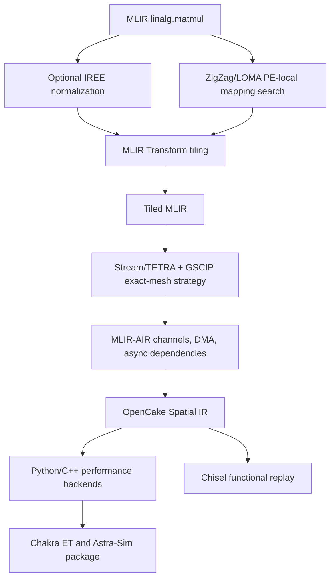

# OpenCake Wafer-Scale GEMM

OpenCake is a research compiler/simulator prototype for mapping one MLIR
`linalg.matmul` onto a wafer-scale PE mesh. The current repository intentionally
contains one complete reference pipeline instead of multiple historical
prototypes.

The default workload is FP32 GEMM with `M=N=K=1024`, mapped to a `32x32` mesh
with one rank per PE and `48 KiB` of local SRAM per PE.

## Pipeline



The stages have separate ownership:

- **IREE** validates and normalizes workload semantics.
- **ZigZag/LOMA** searches PE-local loop order and memory residency.
- **MLIR Transform Dialect** performs the actual M/N/K tiling rewrite.
- **Stream/TETRA + OR-Tools GSCIP** selects placement, multicast routes, and a
  steady-state schedule on the full `32x32` mesh.
- **MLIR-AIR** materializes PE hierarchy, channels, DMA, and async dependencies.
- **OpenCake** adds wafer-specific SRAM, color, physical route, and timing
  semantics, then emits one Spatial IR consumed by both backends.

See [docs/current_gemm_pipeline.md](docs/current_gemm_pipeline.md) for the
stage-by-stage data path and cycle model.

## Repository Layout

```text
examples/mlir_gemm/                 Current 1024^3 GEMM entry point
src/wafersim/opencake/              Compiler, Spatial IR, and performance model
cpp/opencake_wafer_backend/         C++ timing backend
integrations/mlir_air_opencake/     Reproducible MLIR-AIR container
chisel/                             Spatial-IR-driven functional RTL replay
tests/                              Current Python pipeline tests and fixtures
docs/current_gemm_pipeline.md       Authoritative design description
```

## Python Setup

```bash
python3 -m venv .venv
.venv/bin/python -m pip install -e '.[iree,zigzag,stream]'
```

The complete path also needs:

1. An official Stream checkout and Python environment. The launcher defaults
   to `/tmp/opencake-stream-toolchain/stream` and
   `/tmp/opencake-stream-toolchain/venv/bin/python`.
2. MLIR-AIR `air-opt`. On macOS, build and start the provided container:

```bash
docker build --platform linux/amd64 -t opencake-mlir-air integrations/mlir_air_opencake
docker run -d --name opencake-air-dev opencake-mlir-air
```

## Run the Full GEMM Example

```bash
.venv/bin/python examples/mlir_gemm/run.py \
  --use-real-iree \
  --air-docker-container opencake-air-dev \
  --spatial-ir-out /tmp/opencake_spatial_ir.jsonl \
  --stage-out-dir /tmp/opencake_stages \
  --out-dir /tmp/opencake_astrasim_package \
  --cpp-backend-dir cpp/opencake_wafer_backend \
  --chisel-out-dir /tmp/opencake_chisel_package
```

The command emits transformed MLIR/AIR stages, Stream allocation evidence,
Spatial IR, Chakra ET/Astra-Sim package files, C++ timing results, and a Chisel
replay package.

## Verify

```bash
.venv/bin/python -m unittest discover -s tests
make -C cpp/opencake_wafer_backend
(cd chisel && sbt test)
```

Generated packages, compiler artifacts, C++ binaries, and Chisel build output
are ignored by Git. Only source, fixtures, and reproducible configuration are
kept in the repository.
