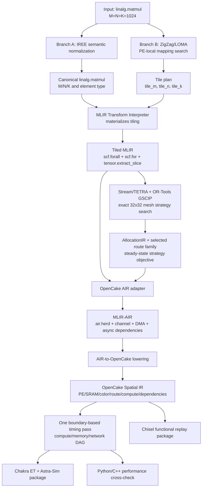

# Current GEMM Pipeline

This document is the source of truth for the current formal GEMM path. The
default example is `C = A x B`, with `M = N = K = 1024`, a 32 by 32 PE mesh,
one rank per PE, FP32 data, and 48 KiB of SRAM per PE.

## End-to-End Flow



There is no GSCIP solve before MLIR Transform. Before Transform, ZigZag/LOMA
only searches PE-local loop and memory mappings. GSCIP first appears after
Tiled MLIR exists, where it selects an exact-mesh streaming strategy.

## Stage 1: Workload and IREE Normalization

**Input:** an MLIR module containing one `linalg.matmul` and tensor shapes.

**Action:** optional real `iree-compile` phases validate and normalize the MLIR.
OpenCake reads the selected IREE phase, recovers `M`, `N`, `K`, data type, and
operator semantics, then emits a stable canonical `linalg.matmul` for the
downstream Transform interpreter.

**Output:** canonical workload MLIR and `GemmWorkload(M, N, K)`.

**Code:**

- `examples/mlir_gemm/run.py:52-70`
- `src/wafersim/opencake/frontend/iree_compiler.py`
- `src/wafersim/opencake/frontend/mlir.py`

IREE does not decide wafer PE placement, colors, routes, or 48 KiB SRAM usage.

## Stage 2: ZigZag/LOMA PE-Local Search

**Input:** `GemmWorkload` and `HardwareSpec`.

**Action:** ZigZag/LOMA searches loop ordering, temporal mapping, spatial use of
the local MAC array, and RF/SRAM residency. OpenCake converts the result into
legal `tile_k` candidates and filters them by:

```text
tile_k <= ZigZag resident-K upper bound
tile_k <= hardware.gemm_k_tile
SRAM(tile_m, tile_n, tile_k) <= 49,152 bytes
K % tile_k == 0
```

For a 32 by 32 mesh and a 1024 by 1024 output, one PE owns one 32 by 32 C tile:

```text
tile_m = ceil(1024 / 32) = 32
tile_n = ceil(1024 / 32) = 32
```

The current default legal result is `tile_k = 32`.

**Output:** `GemmTilePlan(32, 32, 32)` plus ZigZag mapping evidence.

**Code:**

- `examples/mlir_gemm/run.py:72-84`
- `src/wafersim/opencake/zigzag.py:91-133`
- `src/wafersim/opencake/zigzag.py:305-345`

This stage does not create a wafer route and does not run GSCIP.

## Stage 3: MLIR Transform Materializes Tiling

**Input:** canonical `linalg.matmul` and `GemmTilePlan`.

**Action:** the Transform Dialect interpreter rewrites the real operation tree.
The M/N dimensions become a parallel `scf.forall` grid; the K reduction becomes
a nested `scf.for`; `tensor.extract_slice` operations identify each local tile.

**Output:** actual Tiled MLIR, not a JSON description that merely resembles it.

```text
scf.forall  : 32 x 32 output-tile grid
scf.for     : K = 0 .. 1024 step 32
extract_slice A[32 x 32]
extract_slice B[32 x 32]
linalg.matmul into C[32 x 32]
```

**Code:**

- `examples/mlir_gemm/run.py:86-93`
- `src/wafersim/opencake/frontend/transform.py:63-143`
- `src/wafersim/opencake/frontend/transform.py:173-245`
- `src/wafersim/opencake/frontend/tiled_mlir.py`

## Stage 4: Exact-Mesh Streaming Strategy Search

**Input:** the parsed Tiled MLIR loop nest and the 32 by 32 hardware model.

**Action:** OpenCake provides only legal wafer route families. For every legal
family, official Stream/TETRA constructs the placement, multicast transfer
plan, routes, buffers, and steady-state schedule. OR-Tools GSCIP solves the
allocation model. The formal path compares four intentional route families:

```text
A east  / B south
A east  / B north
A west  / B south
A west  / B north
```

The family with the smallest valid Stream steady-state objective is selected.
These four solves are candidate comparison, not duplicate execution of the
same schedule.

**Output:** selected `GemmStreamAllocationContract`, AllocationIR, route hops,
and Stream steady-state objective/trace.

**Code:**

- `examples/mlir_gemm/run.py:95-112`
- `src/wafersim/opencake/stream_strategy.py:491-623`
- `src/wafersim/opencake/stream_strategy.py:656-701`
- `src/wafersim/opencake/stream_strategy.py:974-1035`

GSCIP is used exactly here in the primary pipeline. It is not involved in the
earlier ZigZag or Transform stages.

## Stage 5: MLIR-AIR Materializes Streaming

**Input:** Tiled MLIR plus the selected streaming contract.

**Action:** OpenCake adapts the selected physical directions to target color
names and builds the AIR-level program. Official AIR passes then materialize
the hierarchy and asynchronous dependencies:

```text
air.herd             -> 32 x 32 PE/rank grid
memref.alloc         -> PE-local A/B double buffers and C buffer
air.channel.put/get  -> producer/consumer streams
air.dma_memcpy_nd    -> local/global memory movement
async tokens         -> communication, compute, and output ordering
```

Two `air-opt` invocations have different jobs: the first lowers the parallel
grid to `air.herd`; the second creates and canonicalizes async dependencies.
They are not duplicate passes.

**Output:** `02g_air_herd.mlir`, `02h_air_streaming_input.mlir`, and
`02i_air_streaming_async.mlir`.

**Code:**

- `src/wafersim/opencake/frontend/air.py:504-603`
- `src/wafersim/opencake/stages.py:494-546`

## Tile-Local Computation

PE `(r, c)` owns:

```text
C[r*32:(r+1)*32, c*32:(c+1)*32]
```

For K phase `p`, where `k0 = p * 32`, it consumes:

```text
A[r*32:(r+1)*32, k0:k0+32]
B[k0:k0+32, c*32:(c+1)*32]
```

and performs:

```text
C_tile += A_tile x B_tile
```

Per phase and PE:

```text
operations = 2 x 32 x 32 x 32 = 65,536 ops
```

Across 32 K phases:

```text
operations per PE = 2 x 32 x 32 x 1024 = 2,097,152 ops
```

`C_tile` stays in local SRAM throughout the K loop. Only A and B chunks are
streamed every phase. The implementation creates one `ComputeOp` per PE and K
phase with exactly this operation count.

**Code:**

- `src/wafersim/opencake/frontend/air.py:573-595`
- `src/wafersim/opencake/mapper/core.py:166-227`

## PE-Local SRAM Layout

With FP32 and `tile = 32 x 32 x 32`:

```text
A buffer 0/1 = 2 x 32 x 32 x 4 = 8,192 bytes
B buffer 0/1 = 2 x 32 x 32 x 4 = 8,192 bytes
C buffer     =     32 x 32 x 4 = 4,096 bytes
total        = 20,480 bytes
utilization  = 20,480 / 49,152 = 41.67%
```

Phase `p` uses buffer slot `p % 2`; while one slot feeds compute, the other can
receive the next K chunk. Double buffering is therefore meaningful overlap,
not duplicated storage with no scheduling purpose.

**Code:**

- `src/wafersim/opencake/frontend/air.py:535-552`
- `src/wafersim/opencake/mapper/core.py:128-161`

## Tile-to-Tile Data Movement

For the selected `A east / B south` family:

1. The west boundary injects one A chunk for each PE row and K phase.
2. A is forwarded through adjacent horizontal PE links from west to east.
3. The north boundary injects one B chunk for each PE column and K phase.
4. B is forwarded through adjacent vertical PE links from north to south.
5. PE `(r, c)` starts phase `p` only after its A and B chunks for `p` arrive.
6. The local C tile is updated, then phase `p+1` can use the alternate buffers.
7. After the final phase, C is written to the output path.

The Spatial IR expands logical multicast into adjacent-hop sends. For example,
one A chunk on row `r` follows `(r,0)->(r,1)->...->(r,31)`. This makes every
physical link, queue dependency, and arrival time visible to the backend.

Colors identify logical streams; physical routes identify actual links. A
color does not replace routing and is not inferred again after AIR lowering.

**Code:**

- `src/wafersim/opencake/mapper/core.py:163-209`
- `src/wafersim/opencake/stages.py:708-831`

## Stage 6: AIR-to-OpenCake Spatial IR

**Input:** AIR operation tree and selected AllocationIR contract.

**Action:** OpenCake performs a mechanical target lowering:

```text
air.herd             -> PE/rank grid
memref.alloc         -> local SRAM allocation
air.channel.put/get  -> send/receive operations
air.dma_memcpy_nd    -> memory-transfer operations
linalg.matmul        -> PE-local compute operations
async token          -> dependency edges
```

The lowering also checks that AIR directions match the selected Stream
contract, so a strategy cannot silently change between tools.

**Output:** validated OpenCake Spatial IR JSONL.

**Code:**

- `src/wafersim/opencake/lowering.py:74-168`
- `src/wafersim/opencake/mapper/core.py:88-227`
- `src/wafersim/opencake/schema.py`

## Stage 7: One Target Timing Pass and Chakra ET

**Input:** Spatial IR dependency DAG and target bandwidth/latency parameters.

**Action:** one boundary-based scheduler assigns timestamps. A compute starts
after its dependencies and local compute resource are ready. A memory action
starts after its dependencies and local memory port are ready. Every adjacent
network hop starts after both its input data and that physical link are ready.

```text
start = max(dependency_ready, resource_ready)
end   = start + duration
```

The Stream/TETRA steady-state trace is used to choose and justify the strategy.
The boundary scheduler is the target performance replay that generates final
Chakra timestamps. It does not choose another tile, direction, color, or route.

**Output:** scheduled DAG, aggregate/rank-sharded Chakra ET, and Astra-Sim
experiment package (`system.json`, `network.yml`, workloads).

**Code:**

- `src/wafersim/opencake/stages.py:708-897`
- `src/wafersim/opencake/chakra.py:223-410`
- `src/wafersim/opencake/astrasim.py:46-170`
- `src/wafersim/opencake/backend.py:44-180`

## Stage 8: Independent Backends

The final Spatial IR is consumed by independent backends:

- Python backend: readable reference timing model.
- C++ backend: formal performance implementation and cross-check.
- Chakra/Astra-Sim package: workload handoff for performance experiments.
- Chisel package: hardware-side functional replay.

These are parallel validation targets. They are not four serial scheduling
passes and must not feed their results back into strategy selection.

## Redundancy Audit

| Item | Current result | Reason |
| --- | --- | --- |
| GSCIP before Transform | Absent | ZigZag/LOMA alone selects PE-local mapping before Transform. |
| Four GSCIP solves after Transform | Required | They compare four legal route families. |
| MLIR Transform | One materialization | It rewrites the actual operation tree once. |
| Two AIR pass groups | Required | Herd lowering and dependency materialization are distinct. |
| Stream schedule plus boundary schedule | Distinct roles | Strategy objective versus final target timestamp replay; no second strategy search. |
| Python/C++/Chisel runs | Required cross-checks | Independent backends consume one Spatial IR. |
| Historical workload paths | Removed | GEMV, memcpy, vector-dot, Conv2, and prototype GEMM entry points are not shipped in this version. |
| Handwritten tiling fallback | Removed | The formal path requires the MLIR Transform interpreter to materialize tiling. |

The primary path has no repeated GSCIP before and after Transform, no repeated
tiling rewrite, and no backend result fed back as a new schedule. The repository
contains only this formal GEMM path and its backend contracts.
